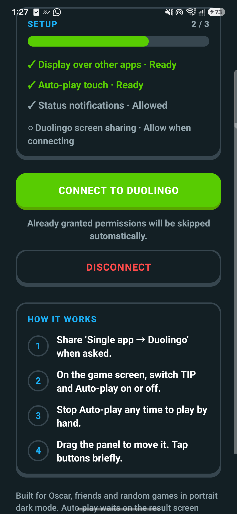
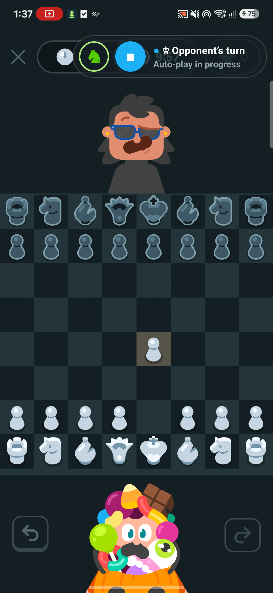

<p align="center"></p>

<h1 align="center">Knightlingo</h1>

<p align="center"><b>Chess tips for Duolingo</b> · best-move arrows and Auto-play, powered by Stockfish<br>
Android app + Chrome extension · everything runs on your own device</p>

<p align="center"><a href="../../releases/latest"><b>⬇ Download the latest release</b></a></p>

> Knightlingo is an independent project. It is **not affiliated with, endorsed by, or connected to Duolingo**.

## What it does

- **Tip:** reads the Duolingo chessboard, asks Stockfish for the best move, and draws an arrow on the board.
- **Auto-play:** plays the suggested move for you, then waits for the opponent's reply.
- **The dock:** a small translucent pill you can drag anywhere. ♞ turns Tip on and off, ▶ starts or stops Auto-play, and the coloured dot shows the state at a glance (green: tip ready, blue: Auto-play running, yellow: reading or confirming, red: error). Tap the text for the full explanation.
- **Private:** the board is read from pixels on your device; nothing is uploaded and no images are stored.

| Android: home | Android: in a game |
|---|---|
|  |  |

## Downloads

Every [release](../../releases) has:

| File | For |
|---|---|
| `Knightlingo-<version>-arm64-v8a.apk` | Android 14 or newer, 64-bit ARM phones |
| `Knightlingo-Extension-<version>.zip` | Chrome, Edge, Brave or another Chromium browser (version 116+) |
| `SHA256SUMS.txt` | Checksums to verify the downloads |

## Android app

### Install

1. Download `Knightlingo-<version>-arm64-v8a.apk` from the [latest release](../../releases/latest) on your phone.
2. Open it. If Android asks, allow your browser or file manager to **install unknown apps**, then tap **Install**.
3. Open **Knightlingo**.

### Set up (once)

1. Tap **Prepare and connect**. Knightlingo walks you through each permission and skips any you have already granted:
   - **Display over other apps:** for the dock and the arrow.
   - **Accessibility → Installed apps → Knightlingo Auto-play → On:** only needed for Auto-play, which taps the board for you. To use tips only, tap **Connect Tip only** instead.
   - **Notifications (optional):** shows that the screen connection is running.
2. When Android asks what to share, choose **Single app → Duolingo**. Don't share the entire screen.

### Use

1. Open a chess match in Duolingo. The dock appears at the top of the screen.
2. Tap **♞** to turn Tip on. On your turn an arrow shows the best move, and the dock shows it as text, e.g. `♞ b8 → c6`.
3. Tap **▶** to start Auto-play, or **■** to stop it and play by hand.
4. Drag the dock off the board if it is in the way. Long-press **♞** to disconnect.

Screen sharing has to be approved again each time you connect; the other permissions are remembered.

## Chrome extension

### Install

1. Download `Knightlingo-Extension-<version>.zip` from the [latest release](../../releases/latest) and unzip it to a folder you'll keep.
2. Open `chrome://extensions` and turn on **Developer mode** (top right).
3. Click **Load unpacked** and select the unzipped folder (the one containing `manifest.json`).
4. Optional: pin Knightlingo from the puzzle-piece menu so its icon is always in the toolbar.

To update, unzip the new version over the same folder and click the reload **↻** on the extension's card.

### Use

1. Sign in at [duolingo.com](https://www.duolingo.com) and open a chess match (`duolingo.com/chess-matches`).
2. The dock appears at the top right of the page and works exactly like the Android one: **♞** for tips, **▶** for Auto-play, drag to move it, tap the text for details.
3. Click the toolbar icon, or long-press **♞**, to hide or show the dock.

The first suggestion takes a moment while the engine loads. When a pawn promotes during Auto-play, choose the promotion piece yourself.

## Fair play

Use Auto-play against Oscar or for practice. Using it in games against other people may break Duolingo's terms and isn't fair to your opponent.

## Build from source

**Android** (JDK 17, Android SDK 36):

```bash
./gradlew testDebugUnitTest assembleDebug
```

Signed release: `scripts/release.ps1 -KeyStore <your.jks> -PasswordFile <password-file>`. Output goes to `artifacts/release-<version>/`.

**Extension** (Node 20+):

```bash
cd extension
npm install
npm test
npm run build   # unpacked extension in extension/dist
```

See [extension/README.md](extension/README.md) for how the extension maps onto the Android code.

## Credits

- Based on the original Android assistant by [cozdx1](https://github.com/cozdx1/duolingo-chess-helper).
- [Stockfish](https://stockfishchess.org) (GPLv3): native build on Android, [stockfish.js](https://github.com/nmrugg/stockfish.js) in the extension. Licence and source notes in [third_party/stockfish](third_party/stockfish).
- [chesslib](https://github.com/bhlangonijr/chesslib) (Android) and [chess.js](https://github.com/jhlywa/chess.js) (extension) for move rules.

Duolingo is a trademark of Duolingo, Inc. Knightlingo is not affiliated with Duolingo.
